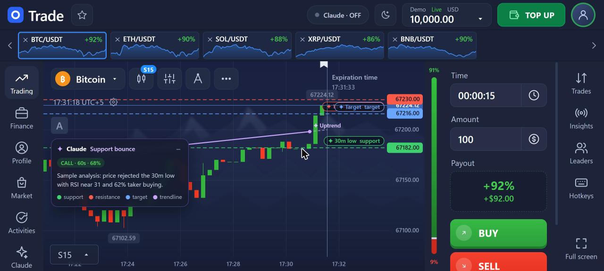

# Tradezz

A **local demo binary-options trading platform** that runs on **real live market prices**, with **Claude as an optional AI trader** that analyses the market, draws its strategy on the chart and places demo trades.

Built to answer one question: *how good is Claude at short-term trading?* So far the honest answer is: close to a coin flip (see [docs/RESULTS.md](docs/RESULTS.md)).



> **Demo money only.** Nothing connects to a real broker, exchange account or wallet. Prices are real (Binance public market data); the balance is a number on your computer. This is not financial advice. Short-term price moves are close to a coin flip, so don't expect any trader, human or AI, to get rich here.
>
> Tradezz is an independent hobby project. It is not affiliated with or endorsed by any broker.

## Features

- **Live prices** for BTC, ETH, SOL, XRP and BNB (vs USDT) streamed from Binance's public WebSocket. No account and no API key needed.
- **Broker-style terminal**: smooth 60fps canvas candlestick chart (candles / Heikin-Ashi / line / area), 11 candle periods (S5 to H1), SMA / EMA / Bollinger Bands, horizontal lines, expiration line, live price tag, high/low tags, crosshair, live buyers-vs-sellers bar.
- **Binary options engine**: BUY (higher) / SELL (lower), 5 s to 1 h expiry, per-asset payouts, live profit/loss on the chart, win / loss / draw settlement, persistent demo account.
- **Claude Trade**: pick a model (Haiku 5.5, Sonnet 5.5 or Opus 5.5) and a style (Conservative / Balanced / Active). Claude reads live candles and indicators for all five assets, **draws support / resistance / target levels and trendlines on your chart**, names the setup, states its confidence and places trades. Low-confidence calls are blocked by the style's threshold.
- **Leaderboard** comparing *you* vs *Claude (API)* vs *Claude Code*: trades, win rate and P/L.
- **Claude box (no API key)**: type a prompt and press **Make Trade**. Three modes: *money only* (`trade with $5000`, Claude chooses stake, duration and timing), *sequential* (`7 trades $1000 each, 30 seconds each, one at a time, analyze 30 seconds before each trade`) and *batch*. Decisions come from a walk-forward-tested logistic regression on live order flow, shown with 8 indicators and 15 chart drawing tools (Fibonacci, order blocks, FVG, trendlines and more).
- **Fable 5.2 trader**: pick Fable in CLAUDE TRADE and it can search the web before deciding. Optional and costs API money.
- **Claude Code mode**: a Claude Code session can trade through the local REST API with no API key (see [CLAUDE.md](CLAUDE.md)).
- **Summary card** after every run: net, ROI, win rate against break-even, and the full trade list.
- Trade history, per-trade reasoning, API cost tracking, sound effects, hotkeys, full screen.

## Docs

- [Setup guide](docs/SETUP.md): install, the three ways to trade, API calls, troubleshooting
- [Architecture and diagrams](docs/ARCHITECTURE.md): system, trade flow, decision logic, autonomous mode
- [Results and honesty notes](docs/RESULTS.md): model tests and live demo results

## Quick start

Requires [Node.js](https://nodejs.org) 22 or newer.

```bash
git clone https://github.com/fadil013/tradezz.git
cd tradezz
npm install
npm start
```

Then open **http://localhost:3000**. On Windows you can double-click `start.bat` instead.

The server binds to `127.0.0.1` only, so it is never exposed to your network.

### Let Claude trade

1. Click **CLAUDE TRADE** under the SELL button.
2. Choose a model and style, paste your [Anthropic API key](https://console.anthropic.com/) (needed once), press **Start**.
3. Watch Claude draw its analysis and trade. Open the **Claude** panel for its reasoning, results and API cost, and **Leaders** to see if it beats you.

Your key is stored only in a local `.env` file (git-ignored) and is sent only to Anthropic. You can also set `ANTHROPIC_API_KEY` yourself, see `.env.example`.

| Model | Roughly per round (5 assets) |
|---|---|
| Haiku 5.5 | ~$0.002 |
| Sonnet 5.5 | ~$0.04 |
| Opus 5.5 | ~$0.09 |
| Fable 5.2 | estimate only, highest |

A round runs every 30 s to 5 min (your choice), so start with Haiku.

## How the game works

- Press **BUY** if you think the price will be higher when the timer ends, **SELL** if lower.
- Right: you win the payout (86 to 92% of the stake). Wrong: you lose the stake. Exactly equal: stake returned.
- Break-even win rate is `100 / (100 + payout)`, about **52 to 54%**.

## Hotkeys

`Shift+W` buy, `Shift+S` sell, `Shift+Up/Down` amount, `Shift+Left/Right` time, `1`-`5` switch asset, `Space` back to live, `F` full screen, `Esc` close panels.

## Project layout

```
server.js        HTTP + SSE + REST API (localhost only)
src/feed.js      Binance WebSocket + klines, candle building
src/broker.js    paper broker: orders, settlement, stats, persistence
src/agent.js     Claude API trader: prompt, strict tool schema, drawings, execution
src/instant.js   Make Trade modes (money-only, sequential, batch) and strategy visuals
src/model.js     logistic-regression model (weights in src/model.json)
src/cc.js        Claude Code session limits, stage, summary
src/indicators.js
public/          web app (chart.js = canvas chart engine, app.js = UI)
```

## Configuration

| Variable | Default | Purpose |
|---|---|---|
| `PORT` | `3000` | Server port |
| `ANTHROPIC_API_KEY` | none | Enables Claude Trade |

## License

MIT, see [LICENSE](LICENSE).
