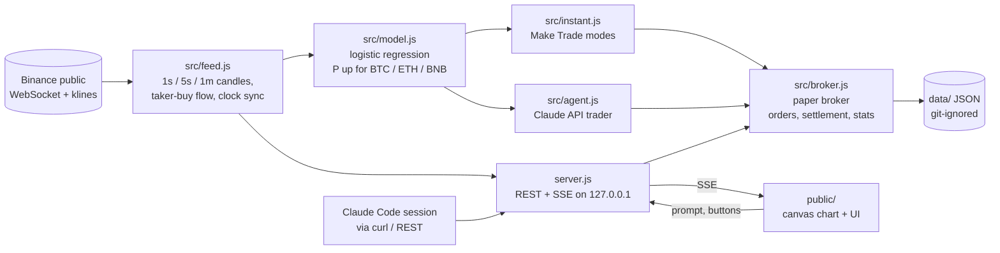
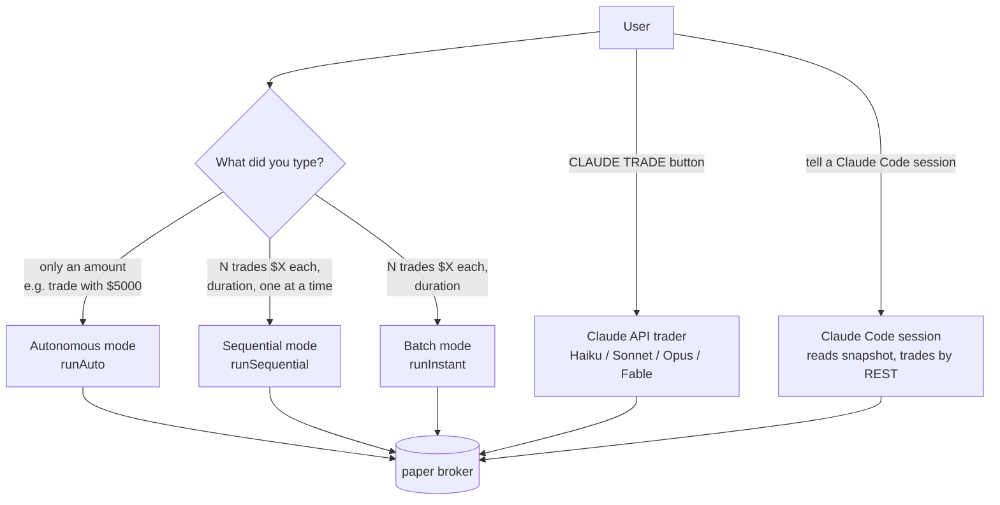
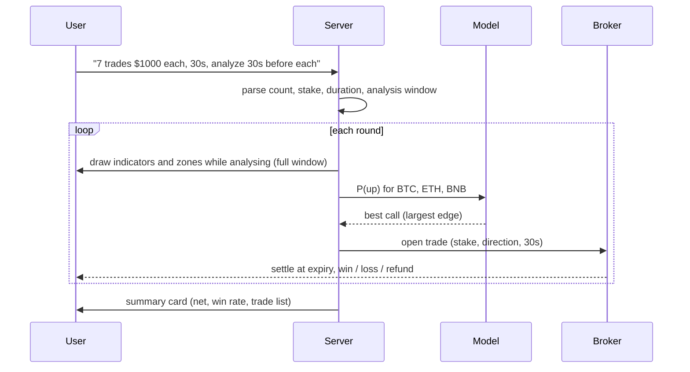
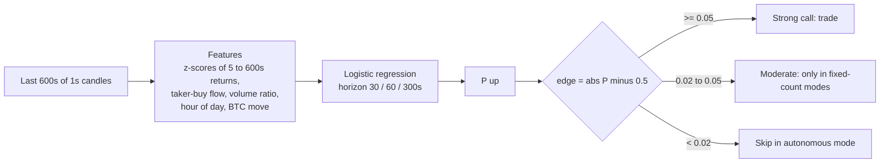
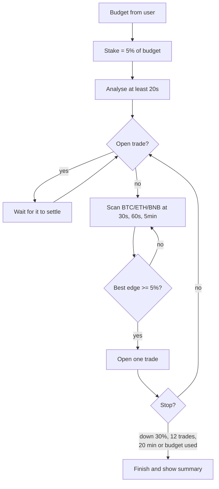

# Architecture

All diagrams are [Mermaid](https://mermaid.js.org/) and render on GitHub.

## 1. System overview

The balance is demo money. Only the prices are real. Nothing connects to a broker, exchange or wallet.

## 2. Three ways to trade

## 3. One round of the sequential mode

## 4. How a trade is decided

The eight classic indicators and the 15 drawing tools on the chart are for display. The model makes the decision.

## 5. Autonomous mode (user gives only the money)

## 6. Settlement

A trade opens at the live price and settles at the live price when the timer ends. Higher for a buy or lower for a sell wins the payout
(BTC 92%, ETH 90%, SOL 88%, XRP 86%, BNB 90%). A wrong call loses the stake. An equal price refunds it.
